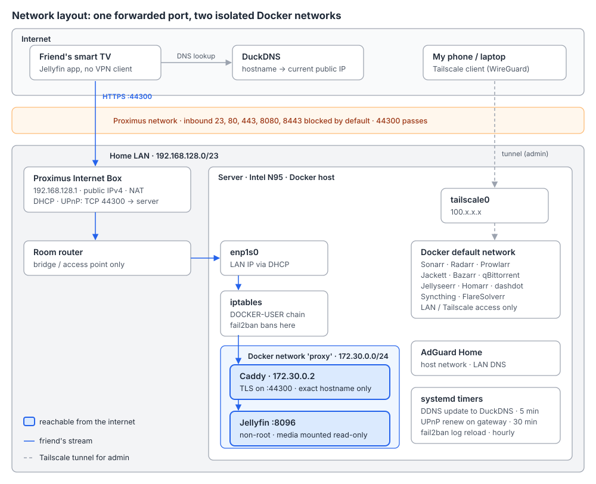
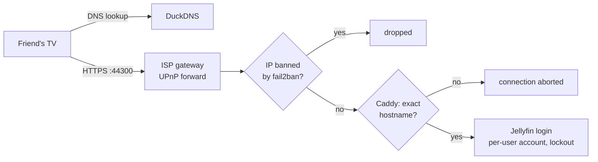

# Homelab media stack: Jellyfin for friends, without a VPN

My friends can stream from my home Jellyfin server on any smart TV over plain HTTPS. They don't need to install anything except the Jellyfin app. One TCP port is open to the internet, and on that port only one hostname reaches one service. Everything else on the server stays reachable only from my LAN or over Tailscale.



## Why

Remote access used to go through Tailscale. That works on phones and laptops, but many smart TVs can't install a VPN client, so friends couldn't watch on the TV. The goal was to expose Jellyfin directly while keeping the attack surface as small as possible.

Constraints:

- **Security first:** expose as little as possible, and contain the damage if something is compromised.
- **No access to the ISP router's web interface** (Proximus Internet Box). Port forwarding had to happen another way.
- **Zero running cost:** free DNS, free certificates, existing hardware.
- **Jellyfin's TV apps can't handle an extra auth layer** (SSO, client certificates), so Jellyfin's own login has to be the authentication. Everything else is about reducing who reaches that login and containing what happens after it.

## How a request gets in



| Layer | Control | Stops |
| --- | --- | --- |
| Exposure | Only TCP 44300 forwarded; no 80, 8096 or admin UIs | Direct attacks on other services |
| Discovery | Wildcard certificate, non-obvious hostname, high port, Caddy drops unknown hostnames | Most scanners, Certificate Transparency log harvesting |
| Transport | Let's Encrypt TLS, HSTS | Eavesdropping, downgrades |
| Authentication | Per-friend accounts, strong passwords, lockout, admin login LAN-only | Credential stuffing, admin takeover |
| Rate limiting | fail2ban on failed logins, banned in the `DOCKER-USER` chain | Brute force |
| Containment | Separate Docker network, non-root user, read-only media, `no-new-privileges` | Lateral movement, data destruction |

The full reasoning and the accepted risks are in [docs/security-model.md](docs/security-model.md).

## Components

| Piece | What it does | Files |
| --- | --- | --- |
| **DuckDNS** | Free DNS name pointing at my changing public IP | [scripts/duckdns-ddns.sh](scripts/duckdns-ddns.sh), [systemd/duckdns-ddns.*](systemd) |
| **UPnP mapping** | Asks the ISP gateway to forward TCP 44300 to the server; renewed every 30 min | [scripts/upnp-map.sh](scripts/upnp-map.sh), [systemd/upnp-map.*](systemd) |
| **Caddy** | TLS termination, wildcard certificate via DNS-01, hostname filter | [caddy/](caddy) |
| **Jellyfin** | Media server, non-root, read-only media, on a network shared only with Caddy | [docker-compose.yml](docker-compose.yml) |
| **fail2ban** | Bans IPs after 3 failed Jellyfin logins in 12 h, for 1 day | [fail2ban/](fail2ban), [systemd/fail2ban-jellyfin-reload.*](systemd) |

### Design choices worth explaining

- **Port 44300, not 443.** Proximus blocks inbound 23, 80, 443, 8080 and 8443 at network level by default, many UPnP gateways refuse mappings below 1024, and a high port draws far fewer scanners. Caddy listens on 44300 inside and outside, so the URL is identical everywhere and doesn't clash with anything else on 443.
- **UPnP instead of a manual port forward.** The gateway's admin page isn't reachable, but it accepts UPnP requests. A timer re-creates the mapping and follows the server's DHCP address. UPnP is a weakness (any LAN device can open ports), so open mappings get checked with `upnpc -l`.
- **Wildcard certificate.** Every certificate is published in public Certificate Transparency logs, which scanners watch for new hostnames. A `*.your-subdomain.duckdns.org` certificate keeps the real Jellyfin hostname out of those logs. DNS-01 also means port 80 never has to be open.
- **Jellyfin off `network_mode: host`.** A host-networked container can reach every service on the server, including ones bound to localhost. On a bridge network shared only with Caddy, a compromised Jellyfin or Caddy has no Docker route to qBittorrent, Homarr or the rest. Trade-off: DLNA no longer works.
- **fail2ban in `DOCKER-USER`.** Traffic to containers is DNATed and passes through the `FORWARD` chain, not `INPUT`, so a default fail2ban ban would never touch it.

## Setup

Tested on Ubuntu with Docker Engine and **Compose v2** (`docker compose`, with a space; Compose v1 fails with `KeyError: 'ContainerConfig'` on current Docker).

### 1. Check the network

You need a real public IPv4, not CGNAT. The gateway must also accept UPnP.

```bash
sudo apt install miniupnpc
upnpc -s              # ExternalIPAddress must match:
curl -4 ifconfig.me
```

See [docs/network-discovery.md](docs/network-discovery.md) for how I worked this out on an unfamiliar network.

### 2. DNS name

Create a subdomain and copy the token at [duckdns.org](https://www.duckdns.org). Every name under the subdomain resolves to the same IP, so the Jellyfin hostname needs no extra record.

```bash
sudo mkdir -p /etc/duckdns
echo 'YOUR_TOKEN' | sudo tee /etc/duckdns/token >/dev/null
echo 'SUBDOMAIN=your-subdomain' | sudo tee /etc/duckdns/env >/dev/null
sudo chmod 600 /etc/duckdns/token
```

### 3. Scripts and timers

```bash
sudo apt install dnsutils
sudo install -m 755 scripts/duckdns-ddns.sh scripts/upnp-map.sh /usr/local/bin/
sudo cp systemd/*.service systemd/*.timer /etc/systemd/system/
sudo systemctl daemon-reload
sudo systemctl enable --now duckdns-ddns.timer upnp-map.timer
```

Check: `upnpc -l | grep 44300` and `dig +short your-host.your-subdomain.duckdns.org @1.1.1.1`.

### 4. Containers

```bash
cp .env.example .env && chmod 600 .env    # fill in the values
mkdir -p config/jellyfin config/jellyfin-cache
sudo chown -R 1000:1000 config/jellyfin config/jellyfin-cache
docker compose config > /dev/null && echo "compose OK"
docker compose up -d --build
docker logs -f caddy                      # wait for "certificate obtained successfully"
```

Adjust the media paths in `docker-compose.yml` to yours. Media is mounted read-only, so in Jellyfin turn off **Save artwork into media folders** and the **NFO** metadata saver.

### 5. Jellyfin settings

| Where | Setting | Value |
| --- | --- | --- |
| Dashboard → Networking | LAN networks | your LAN subnet |
| Dashboard → Networking | Known proxies | `172.30.0.2` (Caddy) |
| Dashboard → Networking | Allow remote connections | On |
| Dashboard → Networking | Enable HTTPS | Off (Caddy handles TLS) |
| Users → admin | Allow remote connections to this server | **Off** |
| Users → each friend | Admin rights, media deletion | Off |
| Users → everyone | Failed login attempts before lockout | 3 to 5 |
| Users → everyone | Hide from login screen | On |

Restart Jellyfin after changing network settings. Without **Known proxies**, every visitor looks like `172.30.0.2` and fail2ban would ban Caddy itself.

### 6. fail2ban

```bash
sudo apt install fail2ban
sudo cp fail2ban/jellyfin.conf /etc/fail2ban/filter.d/
sudo cp fail2ban/jellyfin.local /etc/fail2ban/jail.d/   # set logpath first
sudo systemctl enable --now fail2ban fail2ban-jellyfin-reload.timer
sudo systemctl restart fail2ban
sudo fail2ban-client status jellyfin
```

The hourly reload timer is needed because Jellyfin starts a new log file every day, and fail2ban only expands the `*` in `logpath` when the jail starts.

### 7. Test from outside

On a phone with Wi-Fi off:

- `https://your-host.your-subdomain.duckdns.org:44300` should show the Jellyfin login with a valid certificate.
- `https://<public IP>:44300` and `https://your-subdomain.duckdns.org:44300` should both fail.
- Three wrong passwords should get your mobile IP listed in `sudo fail2ban-client status jellyfin`.

## Docs

- [Network discovery](docs/network-discovery.md): subnet, CGNAT check and gateway identification
- [Security model](docs/security-model.md): what's exposed, and the risks I accepted
- [Troubleshooting log](docs/troubleshooting.md): every problem I hit during setup and how I fixed it
- [Maintenance and roadmap](docs/maintenance.md)

## Roadmap

- Hardware transcoding with Intel Quick Sync (the N95 decodes HEVC 10-bit and AV1)
- An own domain with Cloudflare DNS, to remove the dependency on DuckDNS
- Geo-blocking in Caddy
- Backups of the Jellyfin config
